<!-- Header -->

  

  

  
  

I'm a final-year software engineering student in Lusaka who builds **backend and distributed systems** that have to hold up under real constraints: patchy connectivity, privacy law, money that must reconcile. I write in **Rust, Go and Python**, document design decisions as I make them, and gate every change with tests and CI.

<table>
<tr><td nowrap>🏆 <b>Award</b></td><td>1st place, 2026 ZAMREN Student Hackathon (ZedLedger)</td></tr>
<tr><td nowrap>🔧 <b>Shipped</b></td><td>100+ merged pull requests across 11 repositories, including a Flutter internship shipping offline-first features to production</td></tr>
<tr><td nowrap>🎓 <b>Studying</b></td><td>BSc Software Engineering, ZCAS University (final year)</td></tr>
<tr><td nowrap>🔎 <b>Open to</b></td><td>Backend and distributed-systems internships; open-source collaboration</td></tr>
</table>

## ◈ Featured Projects

### Nexus — personal device mesh *(active)*
Mount a paired device's files as a real filesystem, stream its screen and migrate app state, all over an mTLS-encrypted, code-paired connection. Built from scratch in Rust.

- **Lazy FUSE filesystem** with vector-clock conflict detection: concurrent edits keep both versions, never silently lose data
- **Device pairing** with a 6-digit code and per-device certificates; proven on a real Android phone → Linux laptop mount, byte-exact
- **Screen streaming** (H.264 over gRPC) and an app-state **migration SDK** with three conflict policies
- **Engineering discipline:** 100+ tests, CI on every PR (build, test, fmt, clippy), branch-protected `main`, 17 ADRs recording each real constraint hit

`Rust` · `Tokio` · `gRPC/tonic` · `FUSE` · `mTLS` · `Android (cargo-ndk)` — [Repository](https://github.com/b5119/nexus)

### CDF SigTrace & CDF Pulse — final-year project
A blockchain-anchored way to check Zambia's public spending. **SigTrace** makes contract integrity verifiable by anyone; **Pulse** lets community monitors confirm project delivery with GPS-tagged photos, offline-first; a monitor flags payments with no confirmed completion.

- **Eight readable integrity checks** over real ZPPA open-contracting data, with SHA-256 anchoring of each signed contract
- **Privacy by architecture:** personal data stays off-chain; outputs are signals for human review, never findings of wrongdoing
- **Honest scope:** Fabric and Polygon are simulated in the prototype, and demonstration data is labelled as such

`Python` · `FastAPI` · `PostgreSQL` · `Solidity` · `React` — 🌐 [Live demo](https://frontend-public-app.vercel.app) · 🔒 source private, walkthrough on request

### 🏆 ZedLedger — national digital ID platform *(1st place, ZAMREN 2026)*

  

A team of four built citizen registration, eNID issuance and civil registration (births and deaths) with blockchain-anchored certificates under hackathon conditions. I was **backend lead** for the identity, mobile-money (GSB / ISO 8583), immigration, blockchain and API-gateway services: seven microservices behind one JWT-validating gateway, with isolated PostgreSQL schemas per domain, aligned to the Data Protection Act No. 3 of 2021.

`Next.js` · `FastAPI` · `Hyperledger Fabric` · `PostgreSQL` · `Docker` — 🔒 private, walkthrough on request

### More work
| Project | What it is |
|:--|:--|
| [ChainBa](https://github.com/b5119/chainba) | Decentralised Chilimba (rotating savings) on Ethereum: Solidity contracts, 23 Hardhat tests, React dApp |
| [GPA Tracker](https://github.com/b5119/gpa_tracker) | Flutter app with offline-first storage, predictive GPA modelling and career-sector mapping |
| [Flask API Dashboard](https://github.com/b5119/flask-api-dashboard) | Multi-API dashboard with a service layer and blueprints |
| [ext4 recovery case study](https://github.com/b5119/ext4-partition-recovery-case-study) | Recovering a filesystem after power loss mid-partition-move; zero data lost |

## ◈ Technical Stack

<table>
<tr><td align="left" nowrap><b>Languages</b> what I ship in</td><td align="left"> </td></tr>
<tr><td align="left" nowrap><b>Backend & APIs</b> services and contracts</td><td align="left">    </td></tr>
<tr><td align="left" nowrap><b>Systems</b> low-level and distributed</td><td align="left">     </td></tr>
<tr><td align="left" nowrap><b>Blockchain</b> contracts and anchoring</td><td align="left">   </td></tr>
<tr><td align="left" nowrap><b>Frontend & Mobile</b> web and cross-platform</td><td align="left"></td></tr>
<tr><td align="left" nowrap><b>Data</b> storage</td><td align="left"></td></tr>
<tr><td align="left" nowrap><b>Infra & Tooling</b> delivery and workflow</td><td align="left"></td></tr>
<tr><td align="left" nowrap><b>Integrating in 2026</b> actively learning</td><td align="left"></td></tr>
</table>

## ◈ GitHub Activity

  

  

## ◈ What I'm Looking For

- **Backend or distributed-systems internships** where I can work on real production constraints
- **Open-source backend contributions:** meaningful pull requests, not surface-level fixes
- **Blockchain infrastructure projects** with a genuine use case

I'm deepening backend architecture, distributed-systems theory (consistency, fault tolerance, replication) and smart-contract security.

📧 [bwalyafrank61@gmail.com](mailto:bwalyafrank61@gmail.com) · 💼 [LinkedIn](https://www.linkedin.com/in/frank-bwalya-64b124275)

Lusaka, Zambia · Updated November 2026

